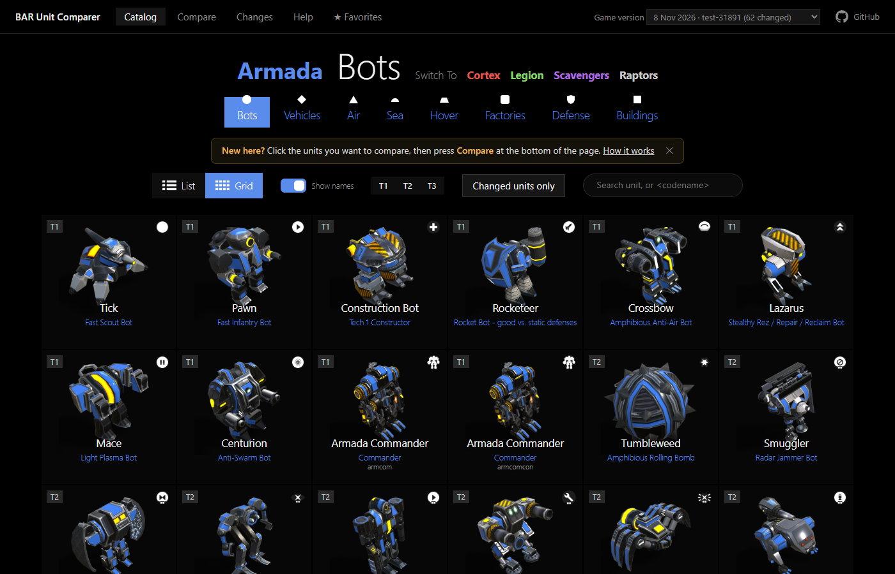
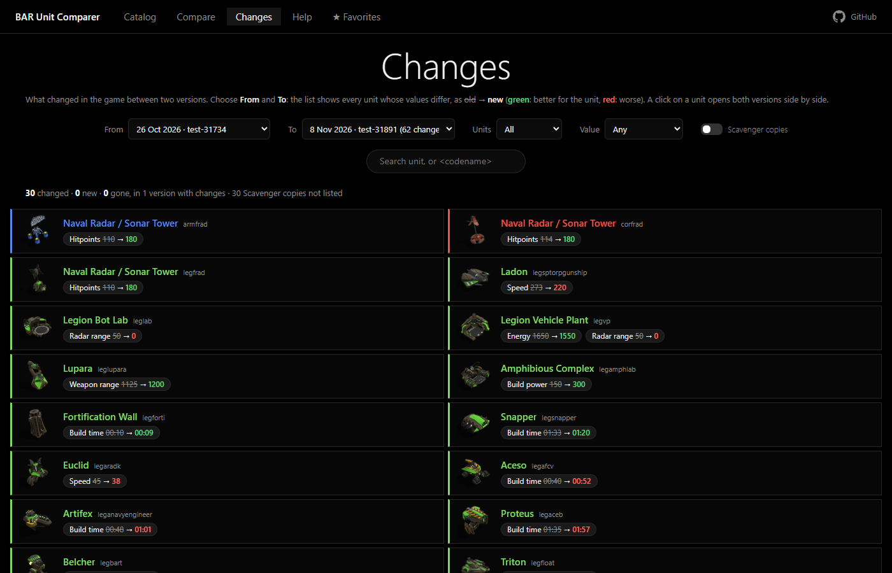

# BARUnitComparer

[](https://github.com/Ralf1108/BARUnitComparer/actions/workflows/pages.yml)

## 👉 [**Open the website: https://ralf1108.github.io/BARUnitComparer/**](https://ralf1108.github.io/BARUnitComparer/) 👈

Look up and compare the units of [Beyond All Reason](https://www.beyondallreason.info/) (BAR): all units of Armada, Cortex, Legion, Scavengers and Raptors, with pictures and values, side by side. Nothing to install: it runs in the browser. An unofficial fan project.

[](https://ralf1108.github.io/BARUnitComparer/)

## How to use it

**1. Pick units in the catalog.** Choose a faction and a category and click the units you want.

[](https://ralf1108.github.io/BARUnitComparer/)

**2. Press Compare.** Every unit is a column, every value a bar. Press **Ref** on one unit and the others turn green (as good or better) or red (worse).

**3. See what a patch changed.** The page **Changes** lists every unit whose values changed between two game versions, old value → new value.

[](https://ralf1108.github.io/BARUnitComparer/#/changes)

The page **Help** on the website explains every button and value.

## What it can do

| | |
|---|---|
| **Catalog** | all units by faction and category, as grid or list, with search and tech level filter |
| **Compare** | any number of units side by side, as bars or as a compact table; columns can be moved by drag and drop |
| **Ref** | one unit is the reference: the others are coloured green or red against it |
| **Counterparts** | the units of the other factions that do the same job; one click adds them all |
| **Counters** | the units that are good against a unit (from the counter charts of beyondallreason.info) |
| **+ Scav** | the Scavenger copy of every unit next to it |
| **Changes** | what changed between any two game versions of the year (from 2026-01-01): changed values, new and removed units |
| **Versions** | the older versions of a unit as columns next to it, the changed values marked |
| **Share and keep** | the link holds the whole comparison; **Favorites** keep selections in your browser; **Undo / Redo** |

Only values count as a change: a new model or texture alone is not listed.

---

## For developers

Everything below is only needed to run the site on your own computer or to make new data.

### How it is made

```
installed game ──► exporter ──► unit data (JSON) ──┐
  (BAR)            (Lua, headless)                  ├──► website/assets/ ──► the website (GitHub Pages)
               └─► renderer ──► unit pictures ──────┘
                   (3D models, Python + browser)
```

The finished data is part of this repository (`website/assets/`). The game is only needed to **make new data**, for example for a new game version.

### Try it locally (without the game)

1. Install [Python 3](https://www.python.org/downloads/).
2. Download this repository (green **Code** button, *Download ZIP*) and unpack it.
3. Double click `website/serve.bat` (or run `python website/serve.py`). The browser opens `http://localhost:8000/`.

### Make new data (needs the game)

Install BAR and start it once (so that a game has been loaded), then double click:

| File | What happens |
|---|---|
| `update game versions.bat` | adds the new game versions: each one that changed a unit value is downloaded, exported and compared with the version before |
| `export and render all units.bat` | makes everything that is missing for the installed game version: unit data and pictures |
| `website/serve.bat` | starts the local web server and opens the website |

All tools, their parameters and requirements: [TOOLS.md](TOOLS.md).

### Folders

| Folder | Content |
|---|---|
| `website/` | the page (HTML, CSS, JavaScript) and its data in `assets/` |
| `exporter/` | gets the unit data out of the game |
| `render_unit/` | makes the pictures from the 3D models |
| `shared/` | code used by several tools |
| `tests/` | automatic tests (run by GitHub on every push: `python -m unittest discover -s tests`, `node tests/website_smoke.mjs`) |
| `docs/` | technical documents |

### Documentation

- [TOOLS.md](TOOLS.md): exporter, renderer, counterparts and counters, requirements
- [exporter/README.md](exporter/README.md), [render_unit/README.md](render_unit/README.md): parameters and output files
- [docs/README.md](docs/README.md): the index of the technical documents: [the website](docs/website.md), [the exporter](docs/exporter.md), [game versions](docs/versions.md) and [the plan for the year](docs/plan-versions-2026.md), [the renderer](docs/renderer.md), [the game's files and formats](docs/game-files.md)

## Licence

The code of this repository is under the [MIT licence](LICENSE). The game data, models and textures of Beyond All Reason have their own licences (mostly CC BY-NC-ND 4.0, see [docs/licence.md](docs/licence.md)). The unit data, the rendered pictures and the icons in `website/assets/` are derived from them: this is an unofficial fan project, the pictures are published with the site, and they are taken down on request of the BAR developers.
