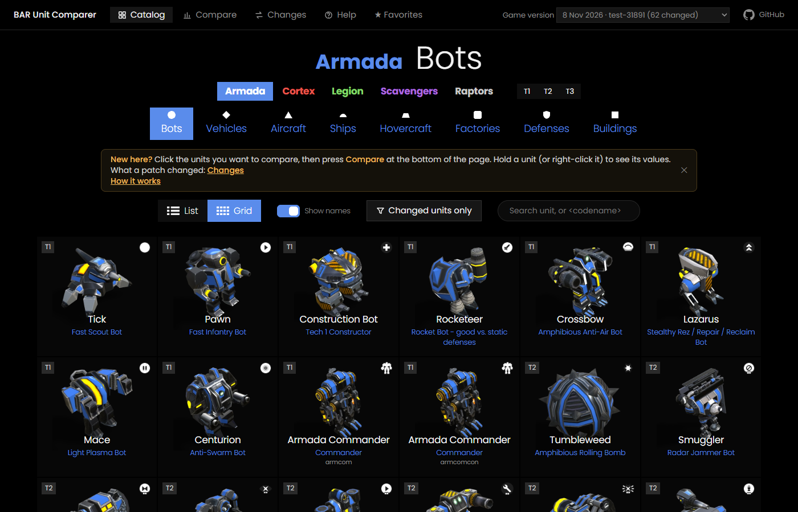
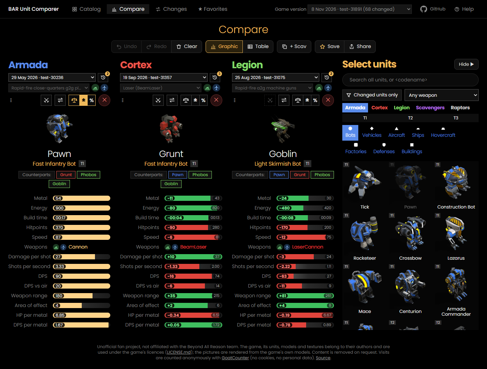
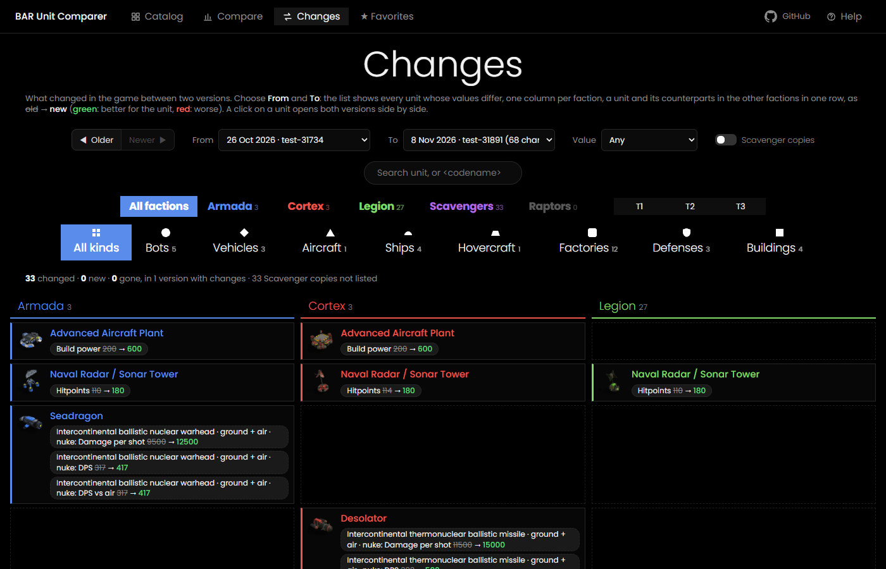
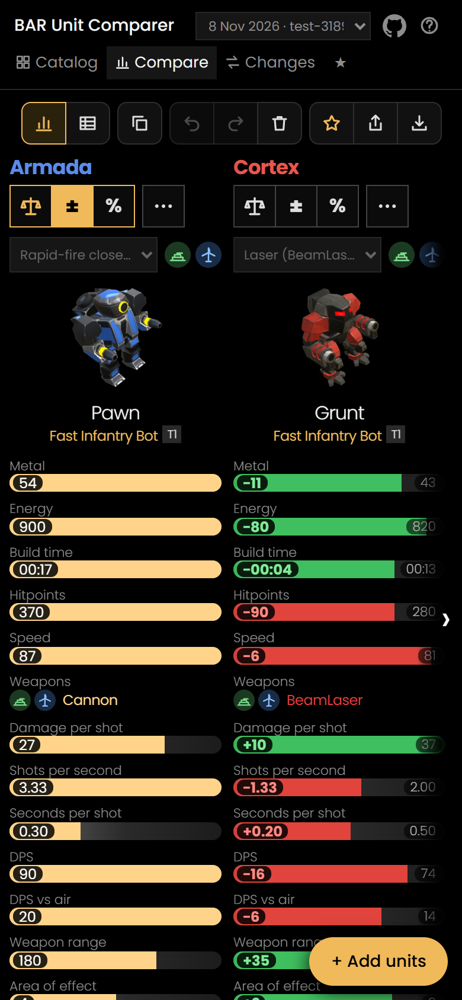

# BARUnitComparer

[](https://github.com/Ralf1108/BARUnitComparer/actions/workflows/pages.yml)

## 👉 [**Open the website: https://ralf1108.github.io/BARUnitComparer/**](https://ralf1108.github.io/BARUnitComparer/) 👈

Look up and compare the units of [Beyond All Reason](https://www.beyondallreason.info/) (BAR): every unit of Armada, Cortex, Legion, Scavengers and Raptors, with pictures and values, side by side, and what each patch of the game changed. It runs in the browser, also on a phone. An unofficial fan project.

## Three pages

### Catalog

Pick a faction, a tech level and a kind of unit, click the units you want, press **Compare**. Hold a unit (or right-click it) to see all its values first. The search finds units of all factions; **Versions** lists only the units that some patch changed.

[](https://ralf1108.github.io/BARUnitComparer/)

### Compare

Every unit is a column, every value a bar (or a row of the table). Add more units from **Select units** at the right (**Changed units only** lists just the units that some patch changed; **Hide** folds it away for more room; **Any weapon** lists every weapon of the game and shows only the units that have the one you choose). The buttons are explained [below](#the-buttons-of-the-compare).

[](https://ralf1108.github.io/BARUnitComparer/#/compare)

### Changes

What a patch changed: every unit whose values differ between two game versions, old value → new value, for a unit with several weapons also per weapon. One column per faction, so a unit and its counterparts in the other factions stand side by side. **◀ Older / Newer ▶** steps through the patches one by one; the search, the kind of value and the same choice of faction, tech level and kind of unit as in the catalog narrow the list.

[](https://ralf1108.github.io/BARUnitComparer/#/changes)

## The buttons of the compare

| Above each unit | |
|---|---|
| **Ref** (balance) | this unit is the reference: the others show the difference to it (**+** more, **−** less), green if that is better, red if it is worse (more metal: **+** in red), equal values grey |
| **Versions** (clock, beside the list of versions) | every other game version of this unit next to it, the changed values marked; the list (white: several versions) shows the unit as it was in one of them |
| **Weapon list** (below the version) | one weapon: its name, grey; several weapons: a white list, **All weapons** (the default) or one of them, e.g. the laser of a commander against the laser of another one; D-gun, nukes and EMP are left out of All weapons but can be chosen |
| **Counterparts** (arrows) | the units of the other factions that do the same job |
| **Counters** (swords) | the units that are good against this unit |

A lit icon pressed again takes back what it added. Drag a column by its grip to move it.

| At the top | |
|---|---|
| **Undo / Redo / Clear** | take back or repeat a change (also Ctrl+Z / Ctrl+Y; the badge says how many steps there are); Clear starts again (it asks first) |
| **Graphic / Table** | bars with pictures, or a compact table |
| **+ Scav** | the Scavenger copy of every unit next to it |
| **Save / Share** | keep the selection as a favorite, or share its link (the link holds everything: units, view, Ref, game version) |

Click the name of a value (Metal, Hitpoints, ...) to sort the columns by it. Besides cost, hitpoints, speed and range the page shows **damage per shot**, **shots per second**, **DPS**, **DPS vs air** and the **area of effect**, and **HP per metal** and **DPS per metal**. The **game version** at the top shows the units as they were in an older patch.

**On a phone:** two units fit on the screen, swipe for more; **Ref** and a menu (three dots) with all tools in words; **+ Add units** opens the selection.

<a href="https://ralf1108.github.io/BARUnitComparer/"></a>

The page **Help** on the website explains every button and value.

---

## For developers

The page is plain HTML, CSS and JavaScript (`website/`, no build step); its data is in the repository (`website/assets/`). The game is only needed to **make new data**.

```
installed game ──► exporter ──► unit data (JSON) ──┐
  (BAR)            (Lua, headless)                  ├──► website/assets/ ──► the website (GitHub Pages)
               └─► renderer ──► unit pictures ──────┘
                   (3D models, Python + browser)
```

**Run it locally:** install [Python 3](https://www.python.org/downloads/), double click `website/serve.bat` (or `python website/serve.py`); the browser opens `http://localhost:8000/`.

**Make new data** (BAR installed and started once):

| File | What happens |
|---|---|
| `update game versions.bat` | finds the new game versions; each one that changed a unit value is downloaded, exported, rendered and compared with the version before |
| `export and render all units.bat` | makes what is missing for the installed game version: unit data and pictures |

**Tests** (run by GitHub on every push, the site is published only if they pass): `python -m unittest discover -s tests` and `node tests/website_smoke.mjs` (needs `npm install` in `render_unit/`).

| Folder | Content |
|---|---|
| `website/` | the page and its data in `assets/` |
| `exporter/` | gets the unit data out of the game |
| `render_unit/` | makes the pictures from the 3D models |
| `shared/`, `tests/` | shared code, automatic tests |
| `docs/` | technical documents: [index](docs/README.md), [the website](docs/website.md), [tools](TOOLS.md) |

## Licence

The code is under the [MIT licence](LICENSE). The game data, models and textures of Beyond All Reason have their own licences (mostly CC BY-NC-ND 4.0, see [docs/licence.md](docs/licence.md)). The unit data, pictures and icons in `website/assets/` are derived from them: this is an unofficial fan project, and they are taken down on request of the BAR developers.
