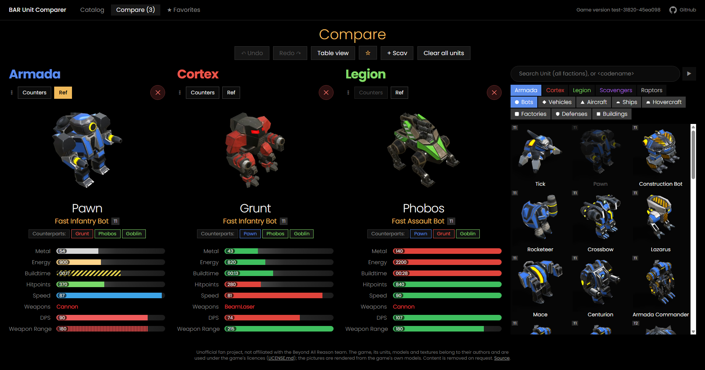

# BARUnitComparer

## 👉 [**Open the website: https://ralf1108.github.io/BARUnitComparer/**](https://ralf1108.github.io/BARUnitComparer/) 👈

Unit catalog and comparison for [Beyond All Reason](https://www.beyondallreason.info/) (BAR): all units of Armada, Cortex, Legion, Scavengers and Raptors, with pictures and values. An unofficial fan project.

## Contents

**Catalog**
- All units by faction and category, as grid or list, with search and tech level filter.
- A click marks a unit for the comparison.

**Compare**
- Any number of units side by side: values as bars, scaled to the largest value in each row, or as a compact table.
- The unit selection at the right edge: search over all units, faction, category; a click on a unit adds a column. Columns can be moved by drag and drop.
- **Counterparts:** the units of the other factions that do the same job, one click adds them all.
- **Counters:** replaces the columns with the units that counter this unit (from the counter charts of beyondallreason.info).
- **Ref:** makes a unit the reference: the bars of all other units turn green (as good or better) or red (worse).
- **+ Scav:** shows the Scavenger copy of every unit next to it.
- **Undo / Redo** of every change of the columns, **Favorites** for selections you want to keep (saved in your browser), and the comparison is kept in the link.

**Tools** (they get the content out of the installed game)
- Exporter: the data of all units as JSON.
- Renderer: pictures of the units from the game's own 3D models.

## Quick start

Install BAR and start it once (so that a game has been loaded), then double click:

| File | What happens |
|---|---|
| `export and render all units.bat` | makes everything that is missing for the installed game version: unit data and data of the website in `website/assets/<version>/data/`, pictures in `website/assets/<version>/images/` |
| `website/serve.bat` | starts the local web server and opens the website |

All tools, their parameters and requirements: [TOOLS.md](TOOLS.md).

## Documentation

- [TOOLS.md](TOOLS.md): exporter, renderer, counterparts and counters, requirements
- [exporter/README.md](exporter/README.md), [render_unit/README.md](render_unit/README.md): parameters and output files
- [SPECIFICATION_WEBSITE.md](SPECIFICATION_WEBSITE.md): the website
- [SPECIFICATION.md](SPECIFICATION.md): the complete description of the tools: data formats, game file formats, decisions

## Licence

The code of this repository is under the [MIT licence](LICENSE). The game data, models and textures of Beyond All Reason have their own licences (mostly CC BY-NC-ND 4.0, see section 7 of the specification). The unit data, the rendered pictures and the icons in `website/assets/` are derived from them: this is an unofficial fan project, the pictures are published with the site, and they are taken down on request of the BAR developers.
